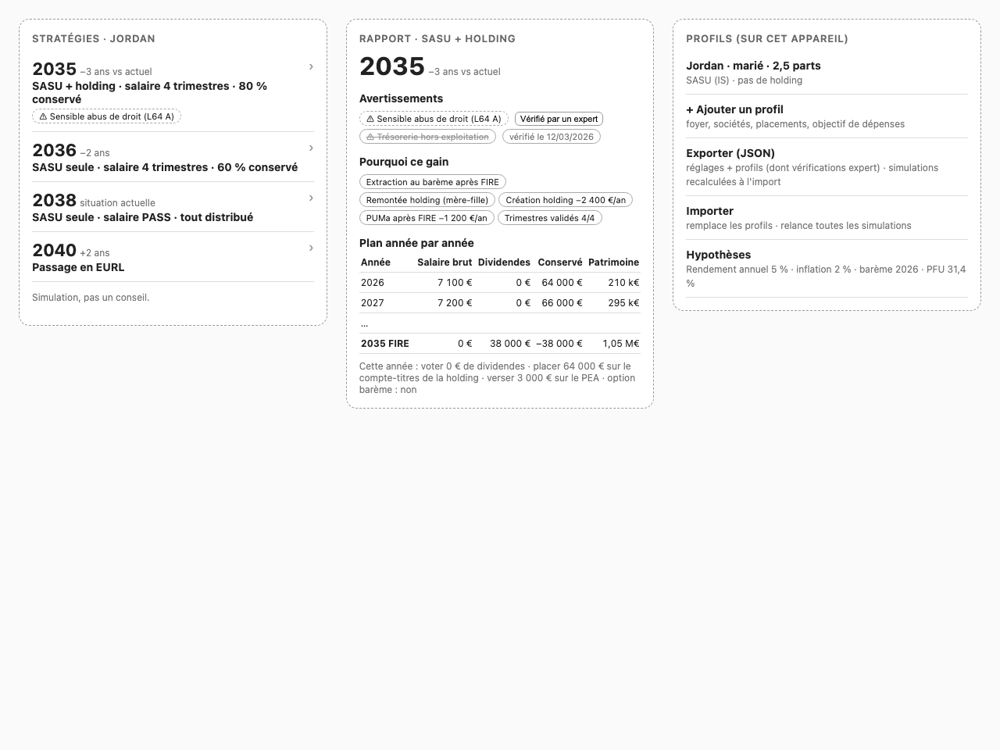

# Design: French FIRE simulator for company owners (local-first PWA)

Generated by /office-hours on 2026-09-30
Branch: omp/01m3s4340yr0mh0wxarhdwv5xt
Repo: Shuunen/rock-solid
Status: DRAFT
Mode: Builder

## Problem Statement

A French company owner (EURL, SARL or SASU at corporate tax (IS), with or without a holding) wants the earliest year their household can reach FIRE (financial independence, retiring early) while supporting a target spending level. The levers:
- how profit leaves the company: salary, dividends, or cash kept inside the company or holding
- where money is invested: PEA, assurance-vie, PER, a securities account (compte-titres) held personally or by a company
- whether to change the legal structure itself: create a holding, change legal form

Household tax inputs matter: marital status, tax shares (parts fiscales), children. The tool is for the user and a few friends, each with their own setup. SCPI is out of scope for V1 (its property-income tax path is listed under Later).

The simulators reviewed this session (mon-entreprise.urssaf.fr, RemUp, Archipel, l-expert-comptable) each optimize **one year's** net pay. A web search for multi-year FIRE/holding simulators ("simulateur FIRE holding trésorerie société") found only generic FIRE tools (FI Simulator, Monte Carlo scripts) with no French company taxation. That search was not exhaustive.

## What Makes This Cool

- The dashboard answers "which setup gets us out earliest?" as a ranked list of FIRE years: "SASU + holding, 4-trimestre salary, keep 75% → 2035, −3 years vs today."
- It also shows moves that are **worse** and why. "Switch to EURL → 2040" because dividends above 10% of (capital + share premiums + shareholder current accounts) pay TNS (self-employed) contributions. The tool can say "don't do that".
- Every strategy links to a full report: the reasons (€ impact per rule), warnings, and a year-by-year plan ending in a concrete "this year: vote €0 in dividends, put €64k into the holding's securities account, €3k into the PEA".

## Constraints

- Personal/family tool, shared with a few friends. Idea stage, nothing built.
- French tax law: Finance Act (LF) n° 2026-103 of 19/02/2026, Social Security Finance Act (LFSS) 2026. Flat tax (PFU) on dividends is 31.4% (12.8% income tax + 18.6% social charges after the +1.4 pt CSG increase). Cap on the tax benefit per extra half-share (plafonnement du quotient familial): 1,807 € for **income year 2025** (economie.gouv.fr; BOFiP BOI-IR-LIQ-20-20-20).
- Friends' real financial data is involved: no server holds it.
- Not regulated financial advice (a CIF license would be required to sell advice). Output is a simulation. Risky setups are flagged for review by an accountant (expert-comptable).

## Premises (agreed)

1. **Earliest *robust* FIRE year, from named strategies** (enumerated in Layer 3). No free per-year optimizer. "Robust" means the model includes the rules that would otherwise make an optimizer give wrong answers (Layer 2), and risky setups carry warnings.
2. **Tax engines.** `modele-social` (the URSSAF Publicodes rules, npm, pinned version) computes social contributions and IS. **Income tax (IR) is our own module**: the user has seen modele-social ignore the family-shares cap (it computed ~10k of tax where the user actually paid ~15k at 2.5 shares). Both are validated against the user's real documents.
3. **Local-first PWA.** Data stays in the browser (IndexedDB, persistent storage requested). No server, no accounts. Export/import is a single JSON file with settings and profiles. Simulation results are never exported; they are recomputed on import.
4. **Structure changes are scenarios with their costs and tax treatment.** Presented as a simulation. Setups sensitive to anti-abuse rules are flagged.
5. **Returns: one configurable assumption** (annual return, inflation). *Revised in the wireframe review:* the dashboard does not show pessimistic/optimistic dates. Monte Carlo is out of scope.
6. **Distribution:** a static PWA on GitHub Pages or Cloudflare Pages, installable.

## Cross-Model Perspective (Claude subagent; Codex not installed)

- **Coolest version:** a "December autopilot". Each December you enter the year's actual figures, the app re-plans next year and shows how many months that year moved the FIRE date. It can also re-run every profile under each new budget law, or under "what-if" law presets (PFU 33%, no 40% allowance, IS 28%).
- **What excites the user:** "the dashboard should say that you have to create an holding or move to an EURL to have the best FIRE date". The product is the comparison between structures, and the headline is how much the FIRE year moves.
- **50% tool:** OpenFisca-France (Python). It models IR including the family-shares cap, and PFU vs barème. Use it **offline to generate test cases**, not at runtime.
- **Challenged premise #1:** "earliest FIRE date" run on an incomplete model finds the model's blind spots. The user accepted the "robust + named strategies" revision.
- **Weekend build:** IR module plus golden tests from real tax notices, then a 30-year loop with 4 named strategies.

## Approaches Considered

- **A: Tax core + fixed strategy table.** Fastest, but hardcoded strategies break as soon as a friend has a different structure. Kept as milestone 1 of B.
- **C: Everything in Publicodes.** Rejected. Publicodes computes one year at a time, so the multi-year state would still live in TypeScript anyway. And **all** our rules (holding, wrappers, drawdown) would have to be written in Publicodes and evaluated through its interpreter on every run. B uses modele-social only for contributions and IS, which can be cached by input (see Performance).

## Recommended Approach: B, a layered engine (A is milestone 1)

Pure TypeScript, running in a Web Worker so the UI never blocks.

### Layer 1: tax packs

- **Packs are keyed by income year** (the year the income is earned). Every parameter in a pack applies to that income year. Milestone 1 ships packs for the income years covered by the golden documents (e.g. 2024, 2025), plus the 2026 pack:
  - PFU 31.4%, PASS 48,060 €, IS 15% up to 42,500 € then 25%
  - IR brackets and QF cap: 2025 values carried forward until LF 2027 publishes the 2026 ones; flagged "provisional" in the UI
- **Social-charge rates per income type**, not one PFU rate. The LFSS 2026 CSG increase reportedly excludes some categories (e.g. assurance-vie gains, property income). The exact scope gets verified in Milestone 1 and stored per type: dividends, securities-account gains, PEA, assurance-vie, PER.
- **High-income rules:** CEHR, plus CDHR (the minimum-tax contribution created by LF 2025). CDHR applicability and parameters for the modeled income years get verified in Milestone 1, since it can bind in big dividend-extraction years.
- **One source of truth per parameter.** Where modele-social exposes a parameter (PASS, SMIC, IS rates, contribution rates), the pack passes it into modele-social through situation overrides. Where it doesn't, a test asserts the pack value equals modele-social's for that year. modele-social's version is pinned; a new budget law that modele-social hasn't caught up with only needs a pack update plus overrides.
- **Projection convention:** everything is in **real euros at 2026 value**. The last pack's thresholds (brackets, QF cap, PASS, SMIC, IS threshold, PUMa thresholds, assurance-vie allowances) stay constant in real terms. This is the same as indexing them to the inflation assumption, so there is no bracket creep. Returns are real returns (nominal minus inflation). modele-social runs with the 2026 parameters on real-euro amounts.

### Layer 2: yearly state (calendar years)

**Household**
- 1 or 2 adults. Each has: age, activity income per company, pension trimestres earned, personal wrappers, PUMa status. Joint taxation for married/PACS couples.
- Supported tax-share (QF) cases in V1: single, married/PACS, children with full or alternating custody (quarter shares), single parent with case T (higher first-child cap). Anything else (disability, widowhood, veterans' half-shares) triggers an "unsupported household" warning and the profile runs without that half-share.
- Tax reductions and credits (childcare, home employment, donations): one yearly amount entered by the user, applied after the capped tax.

**Companies** (0..n per adult)
- Types: SASU/SAS, EURL/SARL with a majority manager (gérant majoritaire), holding. SARL minority partners are not modeled; the user enters their own share.
- Balance sheet: profit, IS, cash, share capital, share premiums, average shareholder current-account balance (these three form the base of the TNS **10% rule**).
- Company investments, each with its own tax rule:
  - securities account (compte-titres): funds flagged exempt or not from art. 209-0 A yearly taxation of unrealized gains
  - contrat de capitalisation: taxed every year on a notional income (art. 238 septies E)
  - cash
- Holding: parent-subsidiary regime (mère-fille) when ownership is ≥5% **and** the shares are held for ≥2 years (the creation year is handled as a commitment). 5% of received dividends are taxable (quote-part de frais et charges). Never applies to the holding's portfolio dividends (<5% stakes). Tax consolidation (intégration fiscale) is out of scope.

**Personal wrappers**
- PEA: opening date, withdrawals after 5 years.
- Assurance-vie: 8-year clock, 4,600/9,200 € allowance.
- Personal securities account.
- PER (Milestone 2): contributions deducted within the yearly ceiling. At exit, deducted contributions are taxed at the income-tax scale and gains at PFU.

**Yearly rules**
- **PUMa** (cotisation subsidiaire maladie) is evaluated **every year**, per adult, from its income conditions: activity income < 20% of PASS and capital income > 50% of PASS. This covers low-salary working years too, not only after FIRE.
- **Pension:** the user enters the estimated full-career pension at legal age (from info-retraite.fr) and the legal age (default 64). The engine prorates it by trimestres earned vs required (a deliberate approximation, flagged in the report) and adds it to drawdown income from legal age on.
- **Returns:** one real annual return for market wrappers, split by a configurable "distributed yield" share (default 0%, i.e. accumulating ETFs). The split drives dividend, 209-0 A and realized-gain taxation.

**Timing:** calendar year = company fiscal year.

| Flow | Rule |
|---|---|
| Profit of year N | IS paid in year N |
| Dividends from N's profit | voted and paid in N+1 |
| IR and personal social charges on N income | cash out in N+1 |
| PUMa on N income | paid in N+1 |
| Deductible CSG (6.8%) | reduces N+1 taxable income when the barème is chosen |

### Layer 3: strategy generator

Dimensions:
- **Salary** (gross remuneration: salary for SASU, TNS remuneration for EURL/SARL): {0, minimum for 4 trimestres (600 × hourly SMIC), 1 PASS}.
- **Retention** (share of after-IS profit kept in the company/holding each working year): {0, 25, 50, 75, 100 %}.
- **Extraction timing** for retained cash:
  - "during work": dividends up to the top of the household's current tax bracket each year
  - "after FIRE": dividends each year sized to the spending gap after personal wrappers, capped at the top of the lowest tax bracket that covers the gap
- **Structure:** the current setup plus valid transitions:
  - add a holding by contributing shares (apport de titres, art. 150-0 B ter deferral, with the reinvestment warning)
  - SASU ↔ EURL/SARL transformation (IS→IS, treated as tax-neutral)

Size: 3 × 5 × 2 × up to 4 structures = **≤120 strategies per profile**, plus the baseline.

- The **baseline** is the user's current setup with their current salary and dividend habits, entered in the profile.
- **Transition costs** are user-editable inputs with documented defaults: incorporation, yearly accounting/legal fees per entity, contribution appraiser (commissaire aux apports) when required.
- **strategyKey** = a stable hash of (structure, salary level, retention, extraction timing). It is independent of generation order and of profile amounts.

### Layer 4: scorer

- **FIRE year:** the first year Y such that, if both adults stop activity income from Y, the household can cover the target spending (real euros) from Y until the younger adult turns 90. Found by searching over Y, with at most ~6 simulations per strategy. V1 has one FIRE year per household.
- **Post-FIRE drawdown order** each year:
  1. dividends from company/holding per the extraction policy
  2. PEA (if >5 years)
  3. assurance-vie within the allowance
  4. personal securities account
  5. remaining assurance-vie
  6. PER (from legal age)
  7. pension (from legal age)
- **At FIRE:** the operating company becomes **dormant**. Its investments stay inside and are extracted as dividends. Recurring structure costs continue (user input). Keeping a large passive portfolio in the operating company raises a `passive-cash-company` warning. Liquidation (liquidation bonus) is not modeled in V1.
- **Edge cases:**
  - Already sustainable → "FIRE possible now", ranked by surplus.
  - Never before 90 → "No FIRE before 90", ranked last, by net worth at 90.
  - Baseline never reaches FIRE → the delta column shows "vs never", and the ranking still works.
- **Reasons trace:** attribution in **euros**, not years. Each rule's effect is the change in net worth at the baseline's FIRE year (or at 65 if none), found by switching the strategy's differences on one at a time, in a fixed documented order: structure → salary → retention → extraction timing → wrappers. The report says the attribution depends on that order. It costs one extra simulation per switch (≤5 per strategy), and runs only when a report is opened.
- **Warnings** use stable rule ids: `anti-abuse-l64a`, `passive-cash-company`, `150-0-b-ter-reinvestment`, `unsupported-household`, `provisional-tax-pack`, `pension-approximation`.

### Performance

- Contribution calls to modele-social are **memoized** by (company type, salary level, pack). With 3 salary levels that is a handful of real evaluations per profile.
- IR, IS brackets, wrappers and drawdown are plain TypeScript arithmetic.
- Budget: ≤120 strategies × ~6 FIRE-year searches × ~60 years ≈ 43k simulated years per profile. **Target: under 3 s in a Web Worker on a mid-range phone.** Benchmarked in Milestone 1. If it's slower: prune dominated strategies after a coarse pass.

### Storage, export and import

- On first launch the app calls `navigator.storage.persist()` and shows the result in Settings. If persistence is denied or the app isn't installed, it prompts for a JSON backup (Safari evicts storage for non-installed sites after 7 days without interaction).
- **Export file:**
  - `schemaVersion`, `appVersion`, `taxPackIds`, `modeleSocialVersion`
  - settings (theme, return/inflation assumptions, tax year)
  - profiles (household, companies, wrappers, target spending, transition-cost overrides)
  - expert verifications
- **Import:**
  1. validate against the schema; show a list of errors, change nothing on failure
  2. migrate older `schemaVersion`s
  3. show a confirmation screen ("replaces all profiles and settings on this device")
  4. auto-download a backup of the current data before overwriting
  5. replace everything and re-run all simulations with the current engine
  6. if versions differ from the export, show a notice that results may differ from those seen on the source device
- **Expert verifications** are stored as `{strategyKey, ruleId, verifiedAt, inputsFingerprint, taxPackId}`. `inputsFingerprint` is a hash of the profile inputs that trigger that rule. If the fingerprint or tax pack changes, the chip comes back as "to re-verify".

### UI

Wireframe approved after one revision:

- **Dashboard:** only the ranked strategy list. FIRE year, difference vs today, **warning chips only**. Each row links to its report.
- **Strategy report:** FIRE year; warnings (can be marked "verified by an expert"); reasons (€ per rule); full year-by-year plan; "this year" actions.
- **Profiles & settings:** profiles on this device, JSON export/import, assumptions, storage persistence status.

## Open Questions

- The sketch shows placeholder numbers only. The first real test is whether "SASU + holding + extract after FIRE" still beats "SASU alone" once PUMa, trimestres, the 5% taxable share and holding costs are included. If it doesn't, the eureka claim is weaker than hoped, and the tool should show that honestly.
- Does modele-social handle the EURL/SARL 10% rule with share premiums and current accounts, or do we compute that base ourselves and pass the TNS dividend part in? Check in Milestone 1.
- Should a strategy the user builds by hand (custom scenario) be profile data (exported)? Default: V1 has no custom strategies; all are generated.
- Couples where each adult may FIRE in a different year: V1 uses one household FIRE year. Separate years are for later.

## Success Criteria

- **IR:** matches the user's golden tax notices on two lines: tax after the family-shares cap (impôt brut après plafonnement) and net tax payable (with reductions/credits entered as their amounts). This includes the 2.5-share year where modele-social was ~5k off, using that income year's pack. It also matches ≥10 OpenFisca-generated cases (capped shares, alternating custody, case T, décote, CEHR, PFU vs barème).
- **Contributions and IS:** the modele-social wrapper matches the user's payslips or URSSAF/DSI statements and the company tax return (liasse fiscale) to within 1% per line for the same income year.
- For the user's real profile, the dashboard ranks all generated strategies including the baseline. Each has a report with a year-by-year plan and a € reasons trace whose items add up to the total € difference (by construction of the sequential method).
- Moving to EURL for a dividend-heavy setup gets penalized by the 10% rule. A company-held contrat de capitalisation never beats an exempt-fund securities account without being flagged. A 0-salary strategy with large dividends pays PUMa during working years.
- Export → clear data → import restores settings, profiles and expert verifications, and produces identical results on the same app version.
- Full profile recompute in under 3 s on a mid-range phone. Works offline once installed. A friend can enter their profile with no account.

## Distribution Plan

Static build (Vite) deployed to GitHub Pages or Cloudflare Pages by a GitHub Actions workflow on every push to `main`. The PWA manifest and service worker (vite-plugin-pwa) make it installable and usable offline. No backend. Friends get a URL, and the app prompts them to install it to protect their storage.

## Next Steps

1. **Golden fixtures first.** Turn the user's real documents into JSON test cases (inputs → amounts actually paid):
   - tax notices (IR)
   - payslips or URSSAF/DSI statements (contributions)
   - company tax return, liasse fiscale (IS)

   Generate ≥10 more IR cases with OpenFisca-France.
2. **Milestone 1** (Approach A inside B's layers):
   - Vite + TypeScript + Vitest scaffold
   - income-year packs for the golden years and 2026, with per-type social-charge rates, and the CSG-scope and CDHR checks
   - IR module until the golden tests pass
   - modele-social wrapper for SASU and EURL at IS, with overrides and memoization
   - yearly state for one household with one company plus securities account/PEA/assurance-vie
   - 4 hand-named strategies; plain table output
   - performance benchmark
3. **Milestone 2:**
   - holding (mère-fille ≥5% and 2 years, 5% taxable share)
   - company investments (209-0 A, 238 septies E)
   - PUMa, trimestres and the pension approximation, PER
   - 10% rule base, structure transitions with costs
   - full strategy generator, € reasons trace, warnings
4. **Milestone 3:**
   - PWA UI per the wireframe
   - Dexie storage with persistence request
   - versioned JSON export/import with validation, backup-before-import and migrations
   - expert verifications with fingerprints
   - offline support; deploy
5. **Later:** SCPI (property-income tax path), liquidation bonus at the horizon, per-adult FIRE years, the December autopilot, budget-law stress tests.

## The Assignment

Before writing any code, gather:
- your last 2 tax notices (avis d'imposition)
- the matching payslips or URSSAF statements
- the latest company tax return (liasse fiscale)

Write them up as 3 test cases in plain JSON: inputs (salaries, dividends, shares, reductions/credits, company profit) → amounts actually paid (IR, social contributions, IS). Include the 2.5-share year where modele-social said ~10k and you paid ~15k. These cases decide whether the engine can be trusted. Every FIRE year the app shows depends on them.

## What I noticed about how you think

- You brought a bug report, not a wish: "with a 2.5 part the simulator said that i should have paid 10k taxes but in reality i've paid 15k because the half part was cap". You measure tools against your real tax notice. That habit is the test strategy for the whole project.
- You didn't just want the tool to optimize inside your current setup: "even the status of the enterprise may be changed if it's not the best option to FIRE". Making the structure a variable is what sets this apart from the simulators reviewed.
- On the wireframe you cut instead of adding: "the optimiste pessimiste date does not add any value", "The why chips should be in the simulation details not on the dashboard". The dashboard is now one ranked list.
- "We should be able to remove those warnings after we do a verification with an expert": you treat warnings as a to-do list to clear with your accountant, not as a legal disclaimer.

<!-- gstack:office-hours:concerns:start -->
## Reviewer Concerns

Disposition: CONCERNS_RECORDED

Stop: CONVERGENCE

### R2-1 — completeness

**Problem**

> Each adult's income is modeled only as 'activity income per company'. There is no input for other income categories that commonly appear on a tax notice and change both compared lines (impôt brut après plafonnement and net tax): a spouse's salary from an outside employer, pensions, interest, capital gains, rental income. A couple where one spouse is a plain employee cannot be entered, and the golden-notice match cannot be guaranteed.

**Remedy**

> Add per-adult inputs for the non-company income categories present in the golden notices (at least an outside salary and other taxable income), or restrict supported households explicitly and warn when a notice contains unsupported categories.

### R2-2 — completeness

**Problem**

> Tax reductions and credits are one yearly amount 'applied after the capped tax'. Reductions cannot make tax negative, but credits (e.g., home employment, childcare) are refundable, and the décote applies before reductions. A single amount cannot reproduce 'net tax payable' when reductions exceed the tax, or when a refund is due.

**Remedy**

> Split the input into non-refundable reductions and refundable credits, and document the order: capped tax → décote → reductions (floored at 0) → credits (can be negative).

### R2-3 — completeness

**Problem**

> Where money is invested is the Problem Statement's second lever, but the document defines no allocation policy. It does not say how personal savings are split across PEA, assurance-vie, PER and the personal securities account each year, or how retained company cash is split between cash, the securities account (exempt or non-exempt funds) and a capitalisation contract. It also omits contribution caps (PEA 150k € contributions, the PER deduction ceiling). Yet the report promises concrete actions like '€3k into the PEA', and the capitalisation-contract success criterion needs such a rule.

**Remedy**

> Define the yearly allocation rule for personal and company savings (fixed priority order or user-set split), including the caps, or make it a generator dimension and update the strategy count.

### R2-4 — consistency

**Problem**

> The 'after FIRE' extraction policy sizes dividends 'to the spending gap after personal wrappers', so wrappers come first and dividends fill the gap. The Layer 4 drawdown order puts company/holding dividends first (step 1), before PEA and assurance-vie. These two rules produce different withdrawals and FIRE years.

**Remedy**

> Choose one order and make the extraction policy and the drawdown list agree.

### R2-5 — clarity

**Problem**

> The pension is listed last (step 7) in the drawdown order, after the PER. A pension is non-discretionary income, not a withdrawal choice. Read literally, the order would drain wrappers before counting pension income that arrives anyway.

**Remedy**

> State that the pension (and any other non-discretionary income) is counted first each year, reducing the spending gap before any discretionary withdrawal.

### R2-6 — clarity

**Problem**

> Both extraction policies are sized on income-tax brackets ('top of the household's current tax bracket', 'top of the lowest tax bracket that covers the gap'). Dividends default to the flat PFU, where brackets do not matter. The document never says how the engine chooses between PFU and the barème option each year, which is a single yearly election for all of the household's capital income. The 'after FIRE' cap is also ambiguous: it does not say what happens when the cap is below the gap (is it uncovered? filled from other sources?).

**Remedy**

> Define the yearly PFU-vs-barème choice (e.g., compute both and keep the cheaper), restate the sizing rules in terms of that choice, and specify the behavior when the cap does not cover the gap.

### R2-7 — clarity

**Problem**

> Retention and 'during work' extraction overlap. Retention decides what share of profit stays in the company, but 'during work' then pays out retained cash up to the top of the bracket, which can undo the retention choice. With 0% retention there is no retained cash, so both timings are identical. The claimed 120 strategies therefore includes duplicates.

**Remedy**

> Define how the extraction timing applies to cash kept under each retention level, collapse duplicate combinations (e.g., 0% retention has no timing), and restate the strategy count.

### R2-8 — clarity

**Problem**

> The household allows 2 adults with 0..n companies each, but the generator's cross-product (3 × 5 × 2 × up to 4) assumes one operating company. The document does not say whether salary, retention, extraction and structure are chosen per company (which multiplies the count, e.g. 120² for two owner-adults) or shared across companies, or how a company owned by the spouse is handled.

**Remedy**

> Specify how the generator handles several companies and two company-owning adults, and restate the strategy count and performance budget, or restrict V1 generation to one operating company with a warning.

### R2-9 — consistency

**Problem**

> Premise 2 says modele-social computes contributions and IS, but Performance says 'IS brackets ... are plain TypeScript arithmetic'. The memoization key (company type, salary level, pack) also leaves out inputs that change the result: IS depends on each year's profit, including company investment income; EURL/SARL TNS contributions depend on the dividend amount above the 10% base; TNS contributions depend on the profit available. So 'a handful of real evaluations per profile' does not hold for the committed rules.

**Remedy**

> Decide which component computes IS. Define a memoization key that covers every input affecting the result (or compute the dividend-driven TNS part and IS in TypeScript), and re-estimate the number of modele-social evaluations.

### R2-10 — feasibility

**Problem**

> The contributions/IS success criterion requires a 1% match against payslips/URSSAF statements and the liasse 'for the same income year', and Milestone 1 ships packs for past golden years. But modele-social is pinned to one version, which encodes one year's formulas, and the doc runs it with 2026 parameters. Situation overrides can change rates and thresholds, but not structural changes between years (e.g., the reform of the TNS contribution base). So past-year contributions may not be reproducible.

**Remedy**

> Check in Milestone 1 which income years the pinned modele-social can reproduce. Either use period-specific modele-social versions for the golden years, or restrict the contributions criterion to income years the pinned version models, and document the fallback.

### R2-11 — feasibility

**Problem**

> The real-euro convention applies real returns, so taxes on gains are computed on real gains. French tax is levied on nominal gains: securities-account and assurance-vie gains, 209-0 A mark-to-market, and the 238 septies E notional income (a nominal rate based on the TME). Taxing only the real part understates capital taxes every year, most of all for taxable company and personal accounts. This biases the ranking between wrappers and structures. It contradicts the claim that the convention is 'the same as indexing', which holds for thresholds but not for tax bases.

**Remedy**

> Track nominal cost basis and apply taxes to nominal gains (converting to real euros for reporting), or document the approximation, its direction, and the wrappers it affects, and flag it in the report.

### R2-12 — clarity

**Problem**

> The return assumption covers 'market wrappers' only. The return on company and holding cash, and on any personal cash, is unspecified. In real euros, cash at a 0% nominal rate loses the inflation rate every year, which matters for high-retention strategies and dormant companies.

**Remedy**

> Specify the real return applied to cash balances (e.g., a configurable cash rate minus inflation).

### R2-13 — feasibility

**Problem**

> The FIRE-year search uses 'at most ~6 simulations per strategy', which implies a binary search that assumes feasibility is monotonic in Y. Several committed rules can break that monotonicity: the PEA 5-year and assurance-vie 8-year clocks, the pension and PER locked until legal age, PUMa thresholds, transition costs, and the 2-year mère-fille holding period. A binary search could then miss the earliest feasible year.

**Remedy**

> Either justify monotonicity for the modeled rules, or use a search that stays correct without it (e.g., a coarse binary search followed by a linear check of earlier years), and update the performance budget.

### R2-14 — clarity

**Problem**

> The reasons trace measures net worth 'at the baseline's FIRE year (or at 65 if none)', but it does not say which activity-stop year is used when simulating the intermediate states produced by the one-at-a-time switches (each has its own FIRE year). It also does not say whose age '65' refers to in a couple.

**Remedy**

> Specify the activity-stop year used for every intermediate simulation (e.g., the same fixed year for all states) and which adult's age defines the fallback year.

### R2-15 — consistency

**Problem**

> The attribution order includes 'wrappers' (structure → salary → retention → extraction timing → wrappers), but wrappers are not a generator dimension, so generated strategies do not differ in wrappers. 'Wrappers' is either a dead step or implies an undefined per-strategy wrapper policy.

**Remedy**

> Remove 'wrappers' from the attribution order, or define the wrapper difference (tied to the allocation policy in R2-3) that a strategy can have compared with the baseline.

### R2-16 — completeness

**Problem**

> The salary dimension treats SASU salary and EURL/SARL TNS remuneration the same way ({0, 600 × hourly SMIC, 1 PASS} 'gross'). A TNS gérant majoritaire may owe minimum contributions (cotisations minimales) even with zero remuneration, and those can validate some trimestres. 'Gross remuneration' is also ambiguous for a TNS, whose contributions are computed on remuneration rather than deducted from it like a salary. The trimestre count per salary level may therefore be wrong for EURL strategies.

**Remedy**

> Define the remuneration basis per status, and specify how minimum TNS contributions and trimestre validation are computed for each salary level (via modele-social or in the engine).

### R2-17 — completeness

**Problem**

> PUMa is evaluated per adult only from that adult's activity and capital income. For married/PACS couples, the contribution is not due if the spouse's activity income is above the 20%-of-PASS threshold. Capital income is also assessed at the household level. Without these rules, a non-working owner married to an employee would be wrongly charged PUMa, or the reverse.

**Remedy**

> Add the spouse's activity-income exemption and household-level capital income to the PUMa rule.

### R2-18 — clarity

**Problem**

> Warning ids are listed, but their trigger conditions are not defined. There is no criterion for `anti-abuse-l64a` and no threshold for `passive-cash-company` ('large passive portfolio'). The expert-verification `inputsFingerprint` is defined as a hash of 'the profile inputs that trigger that rule', so it cannot be built without those triggers.

**Remedy**

> Define each warning's trigger condition and the input fields it depends on (these fields are the fingerprint's inputs).

### R2-19 — clarity

**Problem**

> The baseline is 'the user's current setup with their current salary and dividend habits, entered in the profile', but the profile fields describing those habits are not specified, and the baseline has no strategyKey. The strategyKey formula uses generator dimensions, so warnings on the baseline cannot be marked as expert-verified with a stable key.

**Remedy**

> Define the baseline's profile fields (salary amount, dividend policy, retention) and a reserved stable strategyKey for the baseline.

### R2-20 — clarity

**Problem**

> Settings include a 'tax year', but packs are keyed by income year, and the projection always uses the 2026 pack in real 2026 euros. The document does not say what the setting changes (the projection start year, the pack used as the constant base, or something else).

**Remedy**

> Define what the tax-year setting controls, or remove it.

### Prior finding evidence

**R1-6 → R2-1 (persisting)**

> Reductions/credits (single amount) and the two compared notice lines are now defined, but the obligation to handle the other income categories present on the golden notices is still unmet: household income is only 'activity income per company'.
<!-- gstack:office-hours:concerns:end -->
